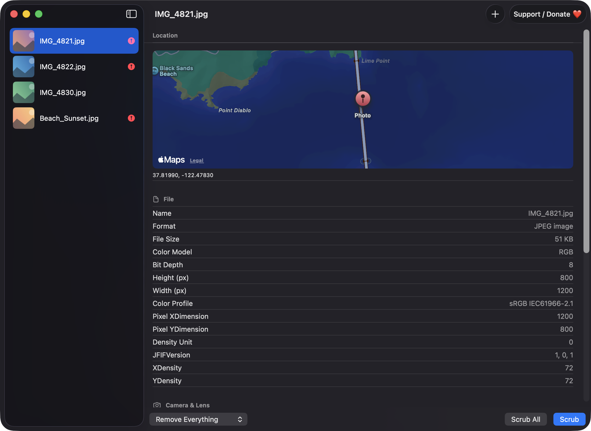
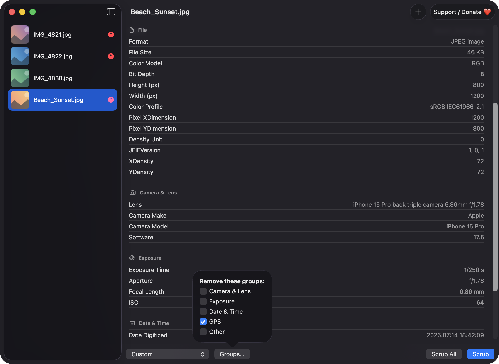
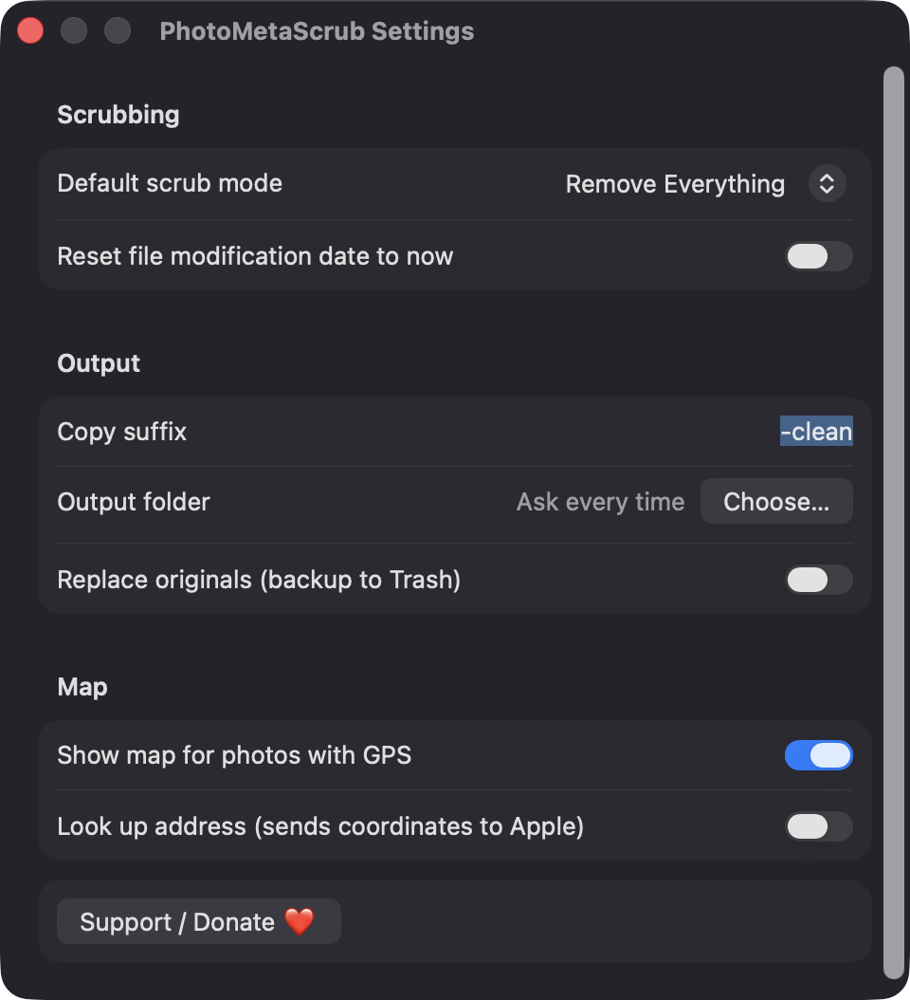

# PhotoMetaScrub

**🌐 Website:** [turhe123.github.io/photo-meta-scrub](https://turhe123.github.io/photo-meta-scrub/)

Drop photos to see their hidden EXIF, GPS and camera data, then strip it all before you share.


## Why

Photos quietly carry GPS coordinates, camera and lens details, and timestamps. PhotoMetaScrub is a free, open-source, 100% native, backend-free alternative to paid utilities in the *Files & Conversion* category, inspired by Metapho ($19.99 /year). It does the two core jobs locally on your Mac: inspect what a photo reveals, and scrub it before you share.

## Features

- **Drop zone for one or many images**: JPEG, HEIC, PNG and TIFF. Drop onto the window or the Dock icon, use **Open…** (⌘O), or open folders (expanded one level deep). Unsupported files are skipped with a note.
- **Grouped metadata viewer**: File, Camera & Lens, Exposure, Date & Time, GPS and Other, read through ImageIO.
- **Sidebar with thumbnails** and a red pin on photos that contain location data.
- **Map for GPS photos** (MapKit pin). Optional address lookup is off by default, because it sends coordinates to Apple.
- **Three scrub modes**: Remove Everything, Remove Location Only, and Custom (choose which groups to remove). Orientation is always preserved, and file-level facts such as pixel size are kept.
- **Output options**: write copies with a configurable suffix (default `-clean`) to a chosen folder, or replace originals after a confirmation, with the originals moved to the Trash as a backup. Name collisions get a counter (`photo-clean 2.jpg`).
- **No recompression where possible**: the compressed image data is copied and the metadata block replaced, then the result is re-read to verify it is clean. If that fails, it falls back to re-encoding at maximum quality and tells you which files were re-encoded.
- **Batch summary** with progress, the number of files that contained location data, and any failures. Read-only folders raise an alert.
- **Menu commands**: Remove Location From All (⇧⌘L), Scrub All (⇧⌘S), Copy Metadata as Text (⇧⌘C), Clear List.
- **Settings**: default scrub mode, copy suffix, output folder, replace-originals toggle, map and address-lookup toggles, and an option to reset the file modification date to now.
- **Support / Donate ❤️** button in the toolbar, the Help menu and Settings.

## Screenshots

<p align="center"></p>

<p align="center"><em>Dropped photos appear in a sidebar with a red pin on those that carry GPS data, and the selected photo&#x27;s location is shown on a map above its grouped metadata.</em></p>

<p align="center"></p>

<p align="center"><em>Camera, lens, exposure and date details are listed by group, and Custom mode lets you pick exactly which groups to remove before scrubbing.</em></p>

<p align="center"></p>

<p align="center"><em>Settings cover the default scrub mode, copy suffix, output folder, replacing originals, and the map and address-lookup privacy toggles.</em></p>

## Install

1. Download `PhotoMetaScrub-macOS.zip` from the [latest release](https://github.com/turhe123/photo-meta-scrub/releases/latest).
2. Unzip it and move `PhotoMetaScrub.app` to `/Applications`.
3. Because the app is open source and not notarized, run:

   ```bash
   xattr -cr /Applications/PhotoMetaScrub.app
   ```

4. Right-click the app and choose **Open** the first time.

## Build from source

Requires macOS 14+ and Xcode with Swift 5.9+.

```bash
brew install xcodegen
xcodegen generate
xcodebuild -project PhotoMetaScrub.xcodeproj -scheme PhotoMetaScrub -configuration Release -derivedDataPath ./build build
```

The app is produced at `build/Build/Products/Release/PhotoMetaScrub.app`.

## Permissions

PhotoMetaScrub does not request Accessibility, Screen Recording, Microphone, Camera, Contacts or Photos-library access. The code contains no such requests.

- **Files and folders you pick**: it reads only images you drop or open, and writes only to the output folder you choose (or beside the originals when replacing them). macOS may show its usual file-access prompts for folders like Desktop or Documents.
- **Network (optional)**: the only network use is the opt-in "Look up address" setting, which sends a photo's coordinates to Apple's geocoder. Map tiles are also loaded by MapKit when a map is shown; turn off "Show map" in Settings to avoid this.

## Built with AI

PhotoMetaScrub was written by [Claude Code](https://claude.com/claude-code) inside an automated pipeline, from a plain-English spec. No code, binaries or assets from any commercial app were used; it is a clean-room reimplementation of a feature set, not a copy.

What that means in practice:

- The full source is in this repo under the MIT license. Read it before you run it.
- No network calls, no analytics, no third-party dependencies. Only Apple frameworks.
- Ad-hoc signed and not notarized, which is why Gatekeeper warns on first launch.
- It has had less human review than a hand-written app. Bug reports and pull requests are welcome.

## Support ❤️

If this saved you some money or some worry, you can support the author: [Support Or (Leo) Davidai ❤️ on Ko-fi](https://ko-fi.com/leodavidai)

## License

MIT © Or Davidai Bachar

## More free Mac apps

Prefer something that runs in the browser? The same pipeline builds [free, private web tools](https://turhe123.github.io/web-tools/): PDF, image, developer, data and audio tools, nothing uploaded.
